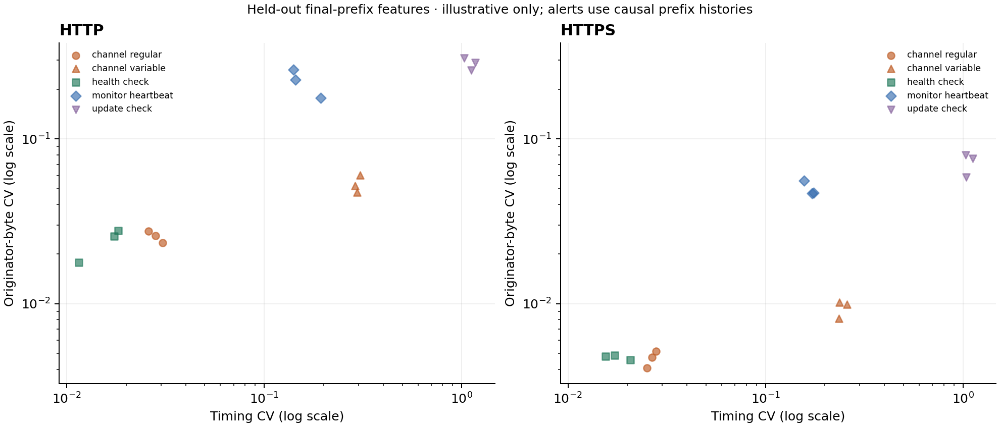

# BeaconLab baseline and refinement audit

This is a retrospective diagnosis of saved observations. The original source files and frozen models are unchanged.

## Where false alerts occur

| Detector | Transport | Benign workload | False alerts / scored benign runs |
|---|---|---|---:|
| Timing | http | health_check | 3/3 |
| Timing | http | monitor_heartbeat | 3/3 |
| Timing | http | update_check | 0/3 |
| Timing | https | health_check | 3/3 |
| Timing | https | monitor_heartbeat | 3/3 |
| Timing | https | update_check | 0/3 |
| Timing + size | http | health_check | 3/3 |
| Timing + size | http | monitor_heartbeat | 0/3 |
| Timing + size | http | update_check | 0/3 |
| Timing + size | https | health_check | 3/3 |
| Timing + size | https | monitor_heartbeat | 3/3 |
| Timing + size | https | update_check | 0/3 |
| Client novelty | http | health_check | 0/3 |
| Client novelty | http | monitor_heartbeat | 0/3 |
| Client novelty | http | update_check | 0/3 |
| Client novelty | https | health_check | 0/3 |
| Client novelty | https | monitor_heartbeat | 0/3 |
| Client novelty | https | update_check | 0/3 |

## Measurement-scale diagnosis

Connection byte counts include protocol overhead. CV = standard deviation / mean, so adding roughly constant bytes reduces CV. HTTP and HTTPS thresholds therefore need explicit evaluation; these observational differences do not isolate a causal effect of TLS.

| Held-out workload | Transport | Median timing CV | Median size CV | Median mean originator bytes |
|---|---|---:|---:|---:|
| channel_regular | http | 0.0282 | 0.0259 | 378.1 |
| channel_variable | http | 0.2949 | 0.0519 | 397.6 |
| health_check | http | 0.0174 | 0.0256 | 374.6 |
| monitor_heartbeat | http | 0.1436 | 0.2286 | 543.1 |
| update_check | http | 1.1178 | 0.2908 | 618.3 |
| channel_regular | https | 0.0267 | 0.0047 | 1997.7 |
| channel_variable | https | 0.2365 | 0.0099 | 2019.7 |
| health_check | https | 0.0172 | 0.0048 | 1999.4 |
| monitor_heartbeat | https | 0.1722 | 0.0472 | 2163.8 |
| update_check | https | 1.0376 | 0.0758 | 2334.3 |

## Development-only gate sensitivity

Each cell refits the same fixed grid on development runs only. These are in-sample diagnostics; they must not be reported as held-out performance or used to retrospectively select a winning test result. Missing cells mean inadequate available evidence.

Raising the minimum can exclude slow benign clients entirely. A lower conditional FPR with lower benign coverage does not establish better detection.

| Transport | Minimum events | Consecutive prefixes | Dev TPR | Dev FPR | Positive coverage | Benign coverage | Median delay (s) |
|---|---:|---:|---:|---:|---:|---:|---:|
| http | 6 | 1 | 100.0% | 33.3% | 100.0% | 100.0% | 0.65 |
| http | 6 | 3 | 100.0% | 33.3% | 100.0% | 100.0% | 0.88 |
| http | 10 | 1 | 100.0% | 33.3% | 100.0% | 100.0% | 1.12 |
| http | 10 | 3 | 100.0% | 33.3% | 100.0% | 100.0% | 1.34 |
| http | 14 | 1 | 100.0% | 0.0% | 100.0% | 66.7% | 1.59 |
| http | 14 | 3 | 100.0% | 0.0% | 100.0% | 33.3% | 1.84 |
| https | 6 | 1 | 100.0% | 33.3% | 100.0% | 100.0% | 0.58 |
| https | 6 | 3 | 100.0% | 33.3% | 100.0% | 100.0% | 0.81 |
| https | 10 | 1 | 100.0% | 33.3% | 100.0% | 100.0% | 1.04 |
| https | 10 | 3 | 100.0% | 33.3% | 100.0% | 100.0% | 1.29 |
| https | 14 | 1 | 100.0% | 0.0% | 100.0% | 50.0% | 1.55 |
| https | 14 | 3 | 100.0% | 0.0% | 100.0% | 33.3% | 1.76 |

## How to read this evidence

- 0 pooled timing-plus-size false alerts no longer matched at the final prefix. They still count as false alerts; later data cannot erase an emitted alert.
- Consecutive cumulative prefixes overlap. Persistence can suppress transient triggers but is not independent confirmation or a solution to sustained benign periodicity.
- `false_positive_cases.csv` traces each benign alert to the exact threshold and causal prefix.
- `alerts.jsonl` provides structured, label-free evidence for a future SIEM adapter. No SIEM ingestion has been performed.
- Class/profile information is joined only for evaluation. It is not an input to prediction.
- Review RESULTS.md/report.html for held-out metrics, uncertainty, paired changes and conclusions.
